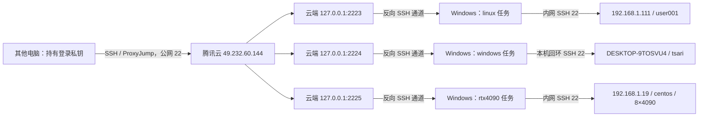

# GAASD：通过 Windows 中转的三条 SSH 隧道

本目录整合自苏州汽车研究院 Windows 中转机 `DESKTOP-9TOSVU4` 的 `D:\Server\gaasd-ssh-relays`。它在总仓库中位于 `ops/windows-ssh-relays/`，与原 `ops/office-tunnel/` 独立。全部入口、端口分配及本次核验见 [中转总览](../../docs/ssh-relays.md)。以下 Windows 路径均指中转机，不是操作者的本地电脑。

内网服务器 `192.168.1.111` 实测为 **8 张 RTX 5090**（每张驱动报告 32607 MiB）；`192.168.1.19` 为另一个 **8 张 RTX 4090** 服务器（每张 24564 MiB），使用新增的 2225 入口。安装器校验固定端口、云端账户、任务名和旧目录，防止与其他中转冲突。本次仅选择安装 `rtx4090`，原有两条任务及 SSH 进程保持运行，详见 [4090 部署记录](../../docs/rtx4090-relay-20261020.md)。

已于 **2026-10-20** 部署在 `DESKTOP-9TOSVU4`。当前机器已经完成安装，日常使用无需重新运行部署脚本。

采用 Windows 自带 OpenSSH 客户端建立三条独立的反向 SSH 隧道；腾讯云复用现有 SSH 服务。由 SYSTEM 计划任务在开机后启动，无需登录 Windows，连接断开后自动重试。整个方案无需安装 frp 或修改现有 Nginx / OpenVPN 代理。

## 链路与端口



图中箭头表示登录流量方向。**三条隧道的 TCP 连接均由 Windows 主动发往腾讯云的 22 端口**，Linux 服务器无需访问外网。

| 用途 | 腾讯云监听地址 | Windows 转发目的地 | 云端隧道账户 | 登录目标账户 |
|---|---|---|---|---|
| 内网 8×5090 | `127.0.0.1:2223` | `192.168.1.111:22` | `gaasd-tsari-relay` | `user001` |
| 本机 Windows | `127.0.0.1:2224` | `127.0.0.1:22` | `gaasd-windows-relay` | `tsari` |
| 内网 8×4090 | `127.0.0.1:2225` | `192.168.1.19:22` | `gaasd-4090-relay` | `centos` |

2223、2224、2225 仅监听腾讯云回环地址，使用腾讯云 SSH 跳板访问；无需开放这些公网端口。现有办公室 Ubuntu 的 2222 / 18765、清华 A100 的 OpenVPN 与网站代理保持原配置。

## 其他电脑如何连接

先将 [`config/client-ssh.example.conf`](config/client-ssh.example.conf) 合并到那台电脑的 `~/.ssh/config`。Windows 对应 `%USERPROFILE%\.ssh\config`。模板假设对应私钥是 `~/.ssh/id_rsa`，如实际文件名不同，请修改四个 `IdentityFile`。

```sh
ssh tsari-via-cloud
ssh windows-via-cloud
ssh rtx4090-via-cloud
```

使用默认密钥路径或已加载 SSH agent 时，也可直接运行：

```sh
# 内网 8×5090
ssh -J ubuntu@49.232.60.144 -p 2223 -o HostKeyAlias=192.168.1.111 user001@127.0.0.1

# 本机 Windows
ssh -J ubuntu@49.232.60.144 -p 2224 -o HostKeyAlias=windows-desktop-9tosvu4 tsari@127.0.0.1

# 内网 8×4090
ssh -J ubuntu@49.232.60.144 -p 2225 -o HostKeyAlias=suzhou-rtx4090-192.168.1.19 centos@127.0.0.1
```

连接有两次认证：先认证腾讯云 `ubuntu`，再认证目标 `user001`、`tsari` 或 `centos`。每个目标独立授权，使用电脑须持有配对私钥。本次指定的两枚 RSA 公钥已在云端 `ubuntu` 和 4090 的 `centos` 入口核验。隧道账户的专用密钥用于 Windows 维持隧道，不用于人员登录。

## 自动启动与恢复

| 任务 | 执行身份 | 触发方式 |
|---|---|---|
| `GAASD-Tsari-SSH-Relay` | SYSTEM / ServiceAccount | 开机延迟 15 秒；每 5 分钟检查并补启动 |
| `GAASD-Windows-SSH-Relay` | SYSTEM / ServiceAccount | 开机延迟 15 秒；每 5 分钟检查并补启动 |
| `GAASD-RTX4090-SSH-Relay` | SYSTEM / ServiceAccount | 开机延迟 15 秒；每 5 分钟检查并补启动 |

- SSH 每 15 秒发送保活，连续 3 次无响应后断开，随后按 5 / 10 / 20 / 40 / 60 秒间隔重试；连接稳定运行 120 秒后重置退避。
- 任务不限运行时长，重复触发不会新建第二个实例；监督脚本异常退出后由任务计划程序重试，并有定期启动作为补充。
- 每条隧道独立配置、账户、密钥、锁和日志。一条中断不需要重启另一条。
- Windows `sshd` 已设为自动启动和服务故障重启。
- Windows 必须开机、保持唤醒，并能访问腾讯云。两条 Linux 路线还分别要求 Windows 能访问 `192.168.1.111` / `192.168.1.19`；关机、睡眠或失去内网路由期间无法使用对应路线。

## 目录

**本仓库源码目录：`ops/windows-ssh-relays/`**（来源目录：中转机 `D:\Server\gaasd-ssh-relays`）

```text
gaasd-ssh-relays/
├── README.md
├── .gitignore
├── .gitattributes
├── cloud/setup-relay-user.py       # 云端创建受限隧道账户，只接收公钥
├── config/
│   ├── client-ssh.example.conf    # 其他电脑的登录配置
│   └── relays.example.json        # 三条隧道的部署参数模板
├── scripts/
│   ├── Common.ps1                # 权限、运行目录与定向停止辅助函数
│   ├── Install-Relays.ps1         # 安装 SYSTEM 开机任务
│   ├── Run-Relay.ps1              # 隧道监督、保活、退避重连
│   ├── Control-Relay.ps1          # 查看、启动、停止、重启
│   ├── Test-RelayRecovery.ps1     # 每条隧道独立模拟连接失败
│   ├── Install-WindowsSsh.ps1     # 新机器可选的 Windows SSH 配置
│   └── authorize-key.py           # 给 Linux 当前用户追加公钥
└── docs/
    ├── DEPLOYMENT.md              # 从零部署及现有任务迁移
    ├── OPERATIONS.md              # 运维、排查与回退
    └── VALIDATION.md              # 实际验证记录及范围
```

正式运行目录是 **`C:\ProgramData\GAASD-SSH-Relays`**，包含管理员保护的脚本、配置、专用私钥、任务备份及日志。任务执行这个受保护目录中的脚本；普通用户不能修改 SYSTEM 执行的程序。

本机部署参数保存在 `D:\Server\relay-deployment.local.json`。原来的 `D:\Server\tsari-relay` 与 `D:\Server\windows-relay` 已停用并保留为历史资料。**上传本源码目录即可**；运行目录、旧目录、安装包和个人 `.ssh` 不属于发布内容。

## 常用管理命令

查看状态：

```powershell
& 'C:\ProgramData\GAASD-SSH-Relays\bin\Control-Relay.ps1' -Action Status
```

以下操作在管理员 PowerShell 中执行：

```powershell
& 'C:\ProgramData\GAASD-SSH-Relays\bin\Control-Relay.ps1' -Action Restart -Name linux
& 'C:\ProgramData\GAASD-SSH-Relays\bin\Control-Relay.ps1' -Action Restart -Name windows
& 'C:\ProgramData\GAASD-SSH-Relays\bin\Control-Relay.ps1' -Action Restart -Name rtx4090
```

详细步骤见 [部署说明](docs/DEPLOYMENT.md)、[运维说明](docs/OPERATIONS.md) 和 [验证记录](docs/VALIDATION.md)。
